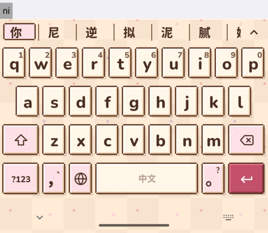
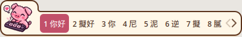
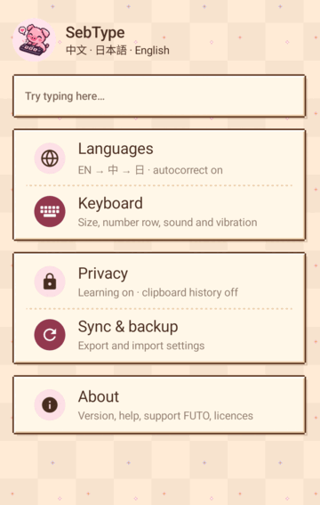

  

<h1 align="center">SebType</h1>

  One keyboard for <strong>中文</strong>, <strong>日本語</strong> and <strong>English</strong>, 
  on an Android phone, on Linux and on Windows.

  
  
  
  

  <a href="#get-it">Get it</a> · <a href="#keys">Keys</a> · <a href="#sync-with-your-own-server">Sync</a> ·
  <a href="#privacy">Privacy</a> · <a href="#credits-and-licences">Credits and licences</a>

<table>
  <tr>
    <td width="60%" align="center" valign="top">
       
      The phone keyboard in 中文  
       
      The candidate window on a PC, here with 繁 on
    </td>
    <td width="40%" align="center" valign="top">
       
      The phone's settings
    </td>
  </tr>
</table>

## What it does

- **Three languages, one keyboard.** Chinese pinyin with [rime-ice (雾凇拼音)](https://github.com/iDvel/rime-ice)
  and the [白霜](https://github.com/gaboolic/rime-frost) dictionary, Japanese romaji with
  [Mozc](https://github.com/google/mozc), and English. `ranh` gives 然后, `nihongo` gives 日本語.
- **The same everywhere.** The phone and the PCs run the same engines with the same Chinese data, so a
  word comes up the same way on each. On the phone all three languages share one layout, with every
  key in the same place.
- **It learns, and it travels.** Words you pick come up first next time. Sync them, and your own Japanese
  and English dictionaries, between your devices through a server you run yourself.
- **Picnic.** A soft peach checkered look with a pixel pig, on the phone keyboard, the PC candidate
  window, the settings and the Windows installer.
- **Offline and private.** Nothing leaves your device except sync to your own server, if you turn it on.

## Get it

| Where | How | Details |
|---|---|---|
| **Android** (arm64) | [Obtainium](https://obtainium.imranr.dev) with `https://github.com/S-Sebb/SebType`, then open SebType and turn it on | [docs/install.md](docs/install.md) |
| **Linux** (KDE Plasma on Wayland, Fedora or Nobara) | `pc/linux/setup-ime.sh` from a checkout: the `sebtype` add-on over Fedora's Fcitx5, in every app, XWayland ones too | [docs/install.md](docs/install.md#linux) |
| **Windows** (64-bit) | `SebType-setup-<version>.exe`: SebType's own text service, with English, 中文 and 日本語 each optional | [docs/install.md](docs/install.md#windows) |

SebType's app id is `dev.sebb.sebtype`, so it installs next to other keyboards such as Gboard. On the PCs,
**SebType Configurator** in the app menu holds the settings: languages and their order, 简/繁, fuzzy
pinyin, your own words, the candidate window, privacy and sync.

  

## Keys

| | Phone | PC |
|---|---|---|
| Switch language | 🌐 next to the space bar: EN → 中 → 日 | **Win+Space**: on Linux, English ⇄ the last other language (the third from the tray menu); on Windows, Windows' own switch, EN → 中 → 日 |
| English letters inside 中文 or 日本語 | | **Shift** tap, and again to go back |
| 简 ⇄ 繁 | in the keyboard's menu | **Ctrl+Shift+F** |
| あ ⇄ ア | the mode chip | **Alt+`** |

The order of the languages is yours to change, in the phone's settings or the Configurator.

## Sync with your own server

There is no SebType cloud. [sync-server](sync-server/README.md) is a small Python server (standard
library only) that you run on a machine of yours, with HTTPS and a login of its own. Enter its address
and login in the phone's **Settings › Sync & backup** or the Configurator. It carries what 中文 learned,
your Japanese and English dictionaries, and the phone's crash reports, nothing else. Offline, everything
is kept on the device and syncs later in the background; typing never waits for it.

Bringing words from elsewhere (a Rime word list, Rime's learned words, Mozc or MS-IME dictionaries):
[docs/import.md](docs/import.md).

## Privacy

- Typing stays on the device. The only network SebType uses is sync, to your server, and only once you
  set it up.
- Password fields and private tabs are always incognito: nothing new is learned from them, and the words
  learned before are still suggested. On the PCs a private tab is one the browser marks private: Chrome's
  and Edge's incognito windows, and Firefox's private windows on Windows. Firefox on Linux doesn't tell
  the input method, so its private windows learn as usual. On the phone a sticky toggle turns incognito
  on anywhere until you turn it off.
- No logs of what you type. Crash reports have typed text taken out and go only to your server.
- The phone's data is left out of Android backups and phone-to-phone transfers.
- On the PCs, the Configurator's Privacy page turns learning off and forgets what Rime or Mozc learned.

## Credits and licences

SebType is its own keyboard for Android, Linux and Windows. It builds on these projects' components:

- **[Rime](https://rime.im)** ([librime](https://github.com/rime/librime), librime-lua, octagram) : Chinese input
- **[rime-ice (雾凇拼音)](https://github.com/iDvel/rime-ice)** and **[白霜拼音 (rime-frost)](https://github.com/gaboolic/rime-frost)**: the Chinese data
- **[Mozc](https://github.com/google/mozc)**: Japanese on every device
- **[AOSP LatinIME](https://android.googlesource.com/platform/packages/inputmethods/LatinIME)**, [llama.cpp](https://github.com/ggml-org/llama.cpp): English suggestions and corrections on SebType's own model
- **[Fcitx5](https://github.com/fcitx/fcitx5)**, [fcitx5-rime](https://github.com/fcitx/fcitx5-rime) and [fcitx5-mozc](https://github.com/fcitx/mozc): input on Linux; [Weasel](https://github.com/rime/weasel): the layout of the Windows candidate window
- **[wordfreq](https://github.com/rspeer/wordfreq)** and [SCOWL](https://wordlist.aspell.net): the English dictionary's frequencies and checks
- **Nunito**, **Pixelify Sans**, **Jersey 10** and **Noto Sans CJK**: the fonts

SebType's own code is under the [MIT licence](LICENSE-SebType). Until 2026-11 (#262) the Android app
was a modified [FUTO Keyboard](https://github.com/futo-org/android-keyboard); the app SebType ships now
contains none of its code or data (see [NOTICE](NOTICE)). Each part keeps the licence of the project it
came from:

<strong>Licences</strong>: which licence covers which part

| Part | Licence |
|---|---|
| SebType's own code: `core/`, `linux/`, `windows/`, `pc/`, `art/`, `data/`, `docs/`, `sync-server/`, `tools/`, `engines/sebtype-lm/`, `.github/` and `android/` (the phone app and its native library; [android/LICENSE](android/LICENSE) lists its exceptions), with the exceptions below. Each folder's `LICENSE` file lists its exceptions | MIT ([LICENSE-SebType](LICENSE-SebType)), Copyright (c) 2026 S-Sebb |
| `data/en-dict/en_US.dict`, the English dictionary: AOSP's en_US words with [wordfreq](https://github.com/rspeer/wordfreq)'s frequencies; its added words were checked against [SCOWL](https://wordlist.aspell.net) | Apache-2.0, and CC BY-SA 4.0 for the frequencies ([NOTICE](NOTICE)) |
| `android/app/src/main/assets/emoji/emoji.txt`: Unicode's emoji list and CLDR's names, with SebType's own ASCII faces | Unicode License v3 |
| The Picnic theme's fonts Nunito and Pixelify Sans, and the glyph outlines in the `pc/icons/` tray icons (Noto Sans CJK and Nunito) | SIL Open Font License 1.1 ([art/fonts/OFL-Nunito.txt](art/fonts/OFL-Nunito.txt), [art/fonts/OFL-PixelifySans.txt](art/fonts/OFL-PixelifySans.txt)) |
| SebType's Mozc (`engines/mozc/`: Mozc with SebType's changes) and `pc/linux/mozc-keymap.tsv` (Mozc's MS-IME keymap with SebType's keys) | BSD-3-Clause, like Mozc |
| `core/src/rime.cpp` (follows fcitx5-rime) and SebType's tray in `linux/src/tray.*` (ported from Fcitx5's notificationitem) | LGPL-2.1-or-later, like fcitx5-rime and Fcitx5 ([LICENSE-LGPL-2.1](LICENSE-LGPL-2.1)) |
| `core/src/mozc.cpp` (follows fcitx5-mozc, Mozc's Fcitx 5 frontend) | BSD-3-Clause, like Mozc |
| SebType's librime (`engines/librime/`: librime with SebType's changes) | BSD-3-Clause, like librime |
| Fedora's librime spec with SebType's changes (`linux/librime.spec`) | MIT, like Fedora's specs |
| RimeJni's build scripts with SebType's changes (`android/native/src/main/cpp/cmake/`: how the phone builds librime; the bundled libraries' licences are in `android/native/src/main/assets/licenses/`) | MIT, like RimeJni |
| librime | BSD-3-Clause |
| The rime-ice and 白霜 data in the APK and on the PCs (see below) | GPL-3.0 |

**Chinese data.** rime-ice's schemas, Lua and settings with the core dictionary and zh-moqi grammar of
白霜拼音 (rime-frost), compiled and bundled in the APK and installed on the PCs. Both are under the
[GNU GPL v3](https://www.gnu.org/licenses/gpl-3.0.html); the licence and a note of what was changed
travel inside the bundle. Sources: rime-ice 2026.06.30 at
[6810e891](https://github.com/iDvel/rime-ice/tree/6810e8916d160498620a16fef2135956fecbd485) and
rime-frost 1.0.4 at
[89ad92e4](https://github.com/gaboolic/rime-frost/tree/89ad92e450f9a5f4dcc2de67ba28004f9af0cc1e),
built by [`data/rime/build.sh`](data/rime/build.sh).

## More

[Install](docs/install.md) ·
[Bring in your words](docs/import.md) ·
[Sync server](sync-server/README.md) ·
[Linux setup](pc/linux/README.md) ·
[Windows setup](pc/windows/README.md) ·
[Build, test and measure](docs/development.md) ·
[Issues](https://github.com/S-Sebb/SebType/issues)

Screenshots come from SebType's test rigs (an emulator and a nested test session) with no personal words.
