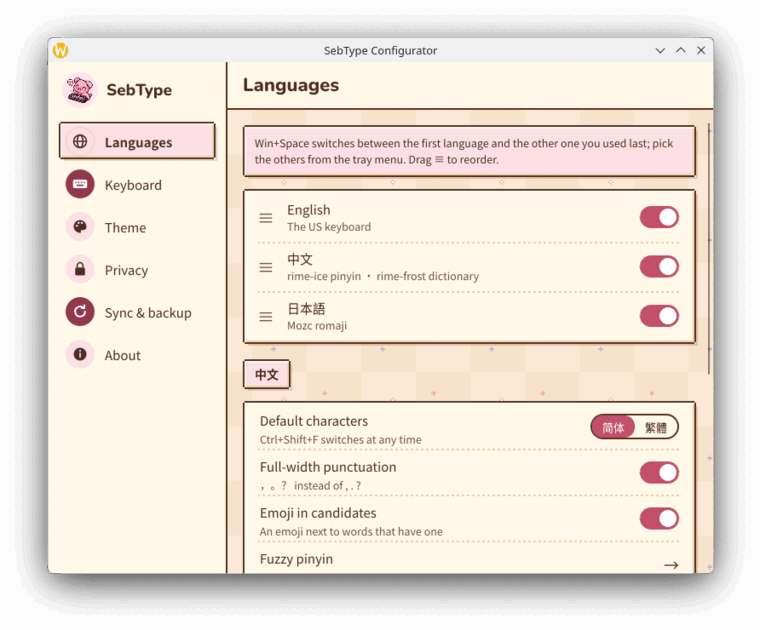

<p align="center">
  
</p>

<h1 align="center">SebType</h1>

<p align="center">
  One keyboard for <strong>中文</strong>, <strong>日本語</strong> and <strong>English</strong>,<br />
  on an Android phone, on Linux and on Windows.
</p>

<p align="center">
  
  
  
  
</p>

<p align="center">
  <a href="#get-it">Get it</a> · <a href="#keys">Keys</a> · <a href="#sync-with-your-own-server">Sync</a> ·
  <a href="#privacy">Privacy</a> · <a href="#credits-and-licences">Credits and licences</a>
</p>

<table>
  <tr>
    <td width="60%" align="center" valign="top">
      <br />
      <sub>The phone keyboard in 中文</sub><br /><br />
      <br />
      <sub>The candidate window on a PC, here with 繁 on</sub>
    </td>
    <td width="40%" align="center" valign="top">
      <br />
      <sub>The phone's settings</sub>
    </td>
  </tr>
</table>

## What it does

- **Three languages, one keyboard.** Chinese pinyin with [rime-ice (雾凇拼音)](https://github.com/iDvel/rime-ice)
  and the [白霜](https://github.com/gaboolic/rime-frost) dictionary, Japanese romaji with
  [Mozc](https://github.com/google/mozc), and English. `ranh` gives 然后, `nihongo` gives 日本語.
- **The same everywhere.** The phone and the PCs run the same engines with the same Chinese data, so a
  word comes up the same way on each. On the phone all three languages share one layout, with every
  key in the same place.
- **It learns, and it travels.** Words you pick come up first next time. Sync them, and your own Japanese
  and English dictionaries, between your devices through a server you run yourself.
- **Picnic.** A soft peach checkered look with a pixel pig, on the phone keyboard, the PC candidate
  window, the settings and the Windows installer.
- **Offline and private.** Nothing leaves your device except sync to your own server, if you turn it on.

## Get it

| Where | How | Details |
|---|---|---|
| **Android** (arm64) | [Obtainium](https://obtainium.imranr.dev) with `https://github.com/S-Sebb/SebType`, then open SebType and turn it on | [docs/install.md](docs/install.md) |
| **Linux** (KDE Plasma on Wayland, Fedora or Nobara) | `pc/linux/setup-ime.sh` from a checkout: the `sebtype` add-on over Fedora's Fcitx5, in every app, XWayland ones too | [docs/install.md](docs/install.md#linux) |
| **Windows** (64-bit) | `SebType-setup-<version>.exe`: SebType's own text service, with English, 中文 and 日本語 each optional | [docs/install.md](docs/install.md#windows) |

SebType's app id is `dev.sebb.sebtype`, so it installs next to FUTO Keyboard and Gboard. On the PCs,
**SebType Configurator** in the app menu holds the settings: languages and their order, 简/繁, fuzzy
pinyin, your own words, the candidate window, privacy and sync.

<p align="center">
  
</p>

## Keys

| | Phone | PC |
|---|---|---|
| Switch language | 🌐 next to the space bar: EN → 中 → 日 | **Win+Space**: English ⇄ the last other language; the third from the tray menu |
| English letters inside 中文 or 日本語 | | **Shift** tap, and again to go back |
| 简 ⇄ 繁 | in the keyboard's menu | **Ctrl+Shift+F** |
| あ ⇄ ア | the mode chip | **Alt+`** |

The order of the languages is yours to change, in the phone's settings or the Configurator.

## Sync with your own server

There is no SebType cloud. [sync-server](sync-server/README.md) is a small Python server (standard
library only) that you run on a machine of yours, with HTTPS and a login of its own. Enter its address
and login in the phone's **Settings › Sync & backup** or the Configurator. It carries what 中文 learned,
your Japanese and English dictionaries, and the phone's crash reports, nothing else. Offline, everything
is kept on the device and syncs later in the background; typing never waits for it.

Bringing words from elsewhere (a Rime word list, Rime's learned words, Mozc or MS-IME dictionaries):
[docs/import.md](docs/import.md).

## Privacy

- Typing stays on the device. The only network SebType uses is sync, to your server, and only once you
  set it up.
- Password fields and private tabs are always incognito: nothing is learned or kept from them. A sticky
  toggle turns incognito on anywhere until you turn it off.
- No logs of what you type. Crash reports have typed text taken out and go only to your server.
- The phone's data is left out of Android backups and phone-to-phone transfers.
- On the PCs, the Configurator's Privacy page turns learning off and forgets what Rime or Mozc learned.

## Credits and licences

SebType stands on these projects:

- **[FUTO Keyboard](https://github.com/futo-org/android-keyboard)**, the base of the phone app, itself
  built on AOSP's LatinIME
- **[Rime](https://rime.im)** ([librime](https://github.com/rime/librime), librime-lua, octagram) and its Android bindings RimeJni
- **[rime-ice (雾凇拼音)](https://github.com/iDvel/rime-ice)** and **[白霜拼音 (rime-frost)](https://github.com/gaboolic/rime-frost)**, the Chinese data
- **[Mozc](https://github.com/google/mozc)**, Japanese on every device
- **[Fcitx5](https://github.com/fcitx/fcitx5)**, [fcitx5-rime](https://github.com/fcitx/fcitx5-rime) and [fcitx5-mozc](https://github.com/fcitx/mozc), on Linux; [Weasel](https://github.com/rime/weasel), whose candidate window the Windows one takes its layout from
- **[wordfreq](https://github.com/rspeer/wordfreq)** and [SCOWL](https://wordlist.aspell.net), the English dictionary's frequencies and checks
- **Nunito**, **Pixelify Sans**, **Jersey 10** and **Noto Sans CJK**, the fonts

SebType is a **modified version of FUTO Keyboard**. It is not made, endorsed or supported by FUTO;
please don't report SebType problems to FUTO.

The Android app is FUTO's code with SebType's changes, under FUTO's
[FUTO Source First License 1.1](LICENSE.md) (see also [NOTICE](NOTICE)). That licence makes it
source-available, not open source: anyone may use it, but it may be modified only for non-commercial
purposes and shared only free of charge and non-commercially, with FUTO's payment features and notices
left in. SebType keeps FUTO's payment screen, with a note on SebType's licence. SebType's own code
outside FUTO's files is under the [MIT licence](LICENSE-SebType). Each part keeps the licence of the
project it came from:

<details>
<summary><strong>Licences</strong>: which licence covers which part</summary>

| Part | Licence |
|---|---|
| FUTO Keyboard's code: `android/app/` other than SebType's files below, `android/tools/contributors.py`, `android/tools/make-keyboard-text-py/`, `.github/ISSUE_TEMPLATE/`, the Gradle files in `android/` (other than `android/build.gradle`), `android/mozc/src/` (FUTO's mozc-lib, Mozc's Android client; Google's parts BSD-3-Clause) and the FUTO files brought in from its submodules (`android/app/src/main/assets/layouts/`, the translations in `android/app/src/main/res/values-ja/` and `values-zh-rCN/`, `android/app/src/main/res/raw/ml4_q6_k.gguf`). SebType's edits inside these files count as FUTO-derived | [FUTO Source First License 1.1](LICENSE.md) |
| The original AOSP keyboard code in those folders, up to commit `d847619a` | Apache-2.0 ([NOTICE](NOTICE)) |
| Code from other projects that FUTO vendored (sentencepiece, protobuf, ggml, llama.cpp, gemoji and others) | each project's own, in its folder |
| SebType's own code: `core/`, `linux/`, `windows/`, `pc/`, `art/`, `data/`, `docs/`, `sync-server/`, `tools/`, `.github/workflows/`, and SebType's own files in `android/` ([android/LICENSE](android/LICENSE) lists them: the scripts, `test/`, `perf/`, the build files of `mozc/` and `rime/`, and in the app the `dev.sebb.sebtype` code, its strings and its launcher icon), with the exceptions below. Each folder's `LICENSE` file lists its exceptions | MIT ([LICENSE-SebType](LICENSE-SebType)), Copyright (c) 2026 S-Sebb |
| `android/app/src/main/assets/layouts/SebType/`: adapted from FUTO's layouts | Apache-2.0, like FUTO's layouts |
| `android/app/src/main/res/raw/emoji_i18n.jsondlgz` (FUTO's emoji names, trimmed) | FUTO Source First License 1.1 |
| `android/app/src/main/res/raw/main_en.dict`, the English dictionary: FUTO's words with [wordfreq](https://github.com/rspeer/wordfreq)'s frequencies; its added words were checked against [SCOWL](https://wordlist.aspell.net) | FUTO Source First License 1.1, and CC BY-SA 4.0 for the frequencies ([NOTICE](NOTICE)) |
| The Picnic theme's fonts Nunito and Pixelify Sans, and the glyph outlines in the `pc/icons/` tray icons (Noto Sans CJK and Nunito) | SIL Open Font License 1.1 ([art/fonts/OFL-Nunito.txt](art/fonts/OFL-Nunito.txt), [art/fonts/OFL-PixelifySans.txt](art/fonts/OFL-PixelifySans.txt)) |
| SebType's Mozc (`engines/mozc/`: Mozc with SebType's changes) and `pc/linux/mozc-keymap.tsv` (Mozc's MS-IME keymap with SebType's keys) | BSD-3-Clause, like Mozc |
| `core/src/rime.cpp` (follows fcitx5-rime) and SebType's tray in `linux/src/tray.*` (ported from Fcitx5's notificationitem) | LGPL-2.1-or-later, like fcitx5-rime and Fcitx5 ([LICENSE-LGPL-2.1](LICENSE-LGPL-2.1)) |
| `core/src/mozc.cpp` (follows fcitx5-mozc, Mozc's Fcitx 5 frontend) | BSD-3-Clause, like Mozc |
| SebType's librime (`engines/librime/`: librime with SebType's changes) | BSD-3-Clause, like librime |
| Fedora's librime spec with SebType's changes (`linux/librime.spec`) | MIT, like Fedora's specs |
| RimeJni with SebType's changes (`android/rime/`: the Kotlin and JNI bindings to librime; its bundled libraries' licences are in `android/rime/src/main/assets/licenses/`) | MIT, like RimeJni |
| librime | BSD-3-Clause |
| The rime-ice and 白霜 data in the APK and on the PCs (see below) | GPL-3.0 |

**Chinese data.** rime-ice's schemas, Lua and settings with the core dictionary and zh-moqi grammar of
白霜拼音 (rime-frost), compiled and bundled in the APK and installed on the PCs. Both are under the
[GNU GPL v3](https://www.gnu.org/licenses/gpl-3.0.html); the licence and a note of what was changed
travel inside the bundle. Sources: rime-ice 2026.06.30 at
[6810e891](https://github.com/iDvel/rime-ice/tree/6810e8916d160498620a16fef2135956fecbd485) and
rime-frost 1.0.4 at
[89ad92e4](https://github.com/gaboolic/rime-frost/tree/89ad92e450f9a5f4dcc2de67ba28004f9af0cc1e),
built by [`data/rime/build.sh`](data/rime/build.sh).

</details>

<details>
<summary><strong>FUTO Keyboard's README</strong>, unchanged</summary>

# FUTO Keyboard

The goal is to make a good modern keyboard that stays offline and doesn't spy on you. This keyboard is a fork of [LatinIME, The Android Open-Source Keyboard](https://android.googlesource.com/platform/packages/inputmethods/LatinIME), with significant changes made to it.

Check out the [FUTO Keyboard website](https://keyboard.futo.tech/) for downloads and more information.

The code is licensed under the [FUTO Source First License 1.1](LICENSE.md).

## Issue tracking and contributing

Please check the GitHub repository to report issues: [https://github.com/futo-org/android-keyboard/](https://github.com/futo-org/android-keyboard/)

The source code is hosted on our [internal GitLab](https://gitlab.futo.org/keyboard/latinime) and mirrored to [GitHub](https://github.com/futo-org/android-keyboard/). As registration is closed on our internal GitLab, we use GitHub instead for issues and pull requests.

Due to custom license, pull requests to this repository require signing a [CLA](https://cla.futo.org/) which you can do after opening a PR. Contributions to the [layouts repo](https://github.com/futo-org/futo-keyboard-layouts) don't require CLA as they're Apache-2.0

If you want to help translate the app, please do so via our Pontoon instance: https://i18n-keyboard.futo.org/

## Layouts

If you want to contribute layouts, check out the [layouts repo](https://github.com/futo-org/futo-keyboard-layouts).

## Building

SebType: see [docs/development.md](docs/development.md).

## APK signing

For official FUTO Keyboard versions, you can verify the APK's signing key fingerprint for integrity.

```
Signing key fingerprint for all versions except Google Play:

MD5: 3A:BB:71:C6:BB:E4:92:27:B1:E3:5D:81:01:48:6A:B0
SHA1: 5D:15:B3:6E:C9:6A:96:28:41:09:DD:62:93:0D:9C:39:9F:5F:06:43
SHA-256: 74:3F:AD:58:64:AB:C4:26:50:0B:2D:C2:C4:7C:8A:D3:24:CB:CD:16:03:3F:80:16:99:48:41:35:63:74:F9:95

```

</details>

## More

[Install](docs/install.md) ·
[Bring in your words](docs/import.md) ·
[Sync server](sync-server/README.md) ·
[Linux setup](pc/linux/README.md) ·
[Windows setup](pc/windows/README.md) ·
[Build, test and measure](docs/development.md) ·
[Issues](https://github.com/S-Sebb/SebType/issues)

Screenshots come from SebType's test rigs (an emulator and a nested test session) with no personal words.
