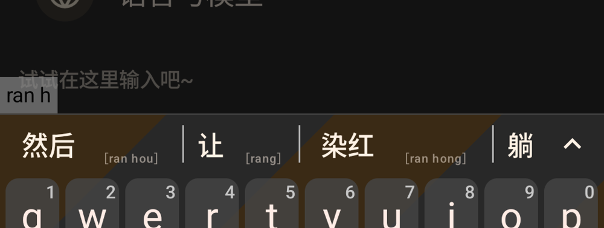

# Experiment: rime-ice as stock FUTO's Chinese dictionary zip (#4)

Question: can stock FUTO Keyboard, with no code changes, run rime-ice for Chinese at the quality in the
Requirements (#1)? Run on 2026-11-09.

**Answer: partly, and only with FUTO's nightly.** The nightly, with the zip from
`tools/pack-rime-ice.sh`, gets rime-ice's dictionary, abbreviations, learning, personal words and
(through a settings backup) the PC's learned words. It can't run any of rime-ice's Lua features, and
the latest release (0.1.30) breaks abbreviations entirely.

## Setup

- Emulator `guide35`: Android 15, x86_64, 2.5 GB RAM, system locale zh-Hans-CN, FUTO's default
  Chinese QWERTY layout with its default settings.
- FUTO Keyboard 0.1.30, the latest release (GitHub `keyboard-0.1.30.apk`, sha256 `0f7bca83…`), and the
  official nightly `0.1.30-19-gf2c079155-unstable` (`dl.keyboard.futo.org/nightly.apk`, sha256
  `fbb3c84e…`, package `org.futo.inputmethod.latin.unstable`, installs alongside the release).
- rime-ice release `2026.06.30` (`full.zip`), packed by `tools/pack-rime-ice.sh` with the PC's
  `fcitx_import.dict.yaml` and the text snapshot of `rime_ice.userdb`. Zip size: 16 MB.

## Results

| Check | 0.1.30 release | Nightly |
|---|---|---|
| Import | PASS | PASS |
| `ranh` → 然后 first | **FAIL**: no 然后; the bar showed only autocorrect guesses (让, 躺, …) | **PASS**: 然后 first, then 让, 染红 |
| `lh` → 厉害 | **FAIL**: no candidates | **PARTIAL**: 8th on a fresh install (rime-ice ranks 联合 first); first after picking it once |
| Learning: pick a lower candidate once, it comes first | not tested (abbreviations broken) | **PASS**: 厉害 picked once from 8th place, first next time; still first after the app process restarts |
| Personal words (`fcitx_import`) | not tested | **PASS**: 4 of 5 checked words are the first candidate, 5 of 5 are in the top 2 |
| PC userdb carries over | not tested | **FAIL** copied as is; **PASS** rewritten by `tools/userdb-to-futo-backup.py` (see below) |
| rime-ice Lua (dates, etc.) | FAIL | **FAIL**: `rq`, `sj`, `xq` and `nl` give ordinary words (日期, 时间, 需求, 能力), and `uuid` gives nothing |
| Emoji candidates (OpenCC, not Lua) | not tested | PASS |
| First deploy after import | 39 s | 39.4 s (plus about 1 s to unpack the zip) |
| RAM during deploy | peak RSS 1.1 GB | peak RSS 1.08 GB (from 198 MB), peak PSS 938 MB |
| RAM in use, after a restart | not tested | PSS 81 MB, RSS 191 MB |

Candidate bar for `ranh` on the nightly:



### Notes on the results

- **`lh` → 厉害** depends on learning, not on rime-ice: rime-ice's own weights put 联合, 良好, 灵活
  and others before 厉害. With the PC's learned words restored, `lh` shows the PC's order, where
  another word learned more often comes first and 厉害 comes second. One pick of 厉害 moves it to first.
- **Personal words**: the one checked word that came second shares its pinyin with a common
  rime-ice word. rime-ice's tables are imported first, so on equal codes rime-ice's word wins, as on
  the PC.
- **PC userdb, packed into the zip**: the zip can only hold dictionaries, not a userdb. The script
  turns the userdb snapshot into a static `pc_userdb` dictionary (weight = times picked). This makes
  the learned words available, but it doesn't reproduce the learned order: 厉害 is in it and stayed
  8th.
- **PC userdb, copied as is** (through FUTO's settings backup, which restores everything under
  `rime/`): Rime opens it, and the LevelDB log then reports
  `Compaction error: Corruption: corrupted compressed block contents`. The learned order doesn't
  apply.
- **PC userdb, rewritten uncompressed**: `tools/userdb-to-futo-backup.py` copies every record into
  an uncompressed LevelDB and puts it into a backup exported from FUTO. After importing that backup,
  there are no LevelDB errors, all 9,857 records (9,852 words plus metadata) are present, and `lh`
  shows the PC's learned order. Importing a backup replaces the phone's own learned words with the PC's.
- **Deploy** compiles the whole rime-ice dictionary on the phone (`rime_ice.table.bin` is 61 MB, and
  the build directory is 76 MB). A redeploy with the build already present (after a settings
  import) took 17 s. Not tried here: rime-ice also publishes `full_compiled.zip` with a prebuilt
  `build/`, which could avoid most of the deploy time and the 1 GB peak.

## What broke, and why (for #3)

1. **The schema id is hard-coded.** FUTO selects `luna_pinyin_simp` for full pinyin (or one of
   its double pinyin ids), never `rime_ice`. The script ships rime-ice's schema under that id and
   limits `default.yaml`'s `schema_list` to the ids FUTO selects. A fork can select `rime_ice` directly.
2. **0.1.30 erases the speller algebra.** FUTO writes `luna_pinyin_simp.custom.yaml` on every
   config change. In 0.1.30 it contains `speller/algebra:` with no rules, which replaces rime-ice's
   whole list. The compiled prism drops from 40 KB to 4 KB, and abbreviations (`ranh`, `lh`) stop
   working. FUTO fixed this on 2026-10-28 (commit 68ead9599, "Fix fuzzy pinyin rules overriding
   speller/algebra", now `speller/algebra/+:`). The fix is in the nightly but not yet in a release.
3. **No Lua.** FUTO's `rime-release.aar` (RimeJni) bundles librime 1.16.1 with librime-predict
   but without librime-lua: `librime-jni.so` has no Lua symbols. Every `lua_processor`,
   `lua_translator` and `lua_filter` in rime-ice is dropped. That loses the date, time and week
   shortcuts, the lunar calendar, UUIDs, Unicode input, number and amount formatting, the calculator,
   以词定字, wrong-pinyin hints, English auto-capitalisation, v-mode symbol ordering, pinned
   candidates, the long-word and English-demotion filters, and radical search.
4. **No snappy in LevelDB.** The same library builds LevelDB without snappy, so it can't read
   userdbs written by desktop Rime, which compresses them. FUTO also never calls Rime's sync, so
   Rime's own text-snapshot merge (`sync/<id>/rime_ice.userdb.txt`) never runs.
5. **FUTO's patch adds its own options.** The same file sets `translator/enable_correction` from
   FUTO's autocorrect setting, which adds correction candidates such as 让 for `ranh`. It also
   adds a `futo_zh_simp` switch tied to `simplifier`, while rime-ice converts to traditional
   characters with `simplifier@traditionalize` on its `traditionalization` switch. So FUTO's
   simplified/traditional setting most likely does nothing with rime-ice. This comes from reading the
   code; it wasn't tested on the device.
6. **The file picker needs a non-`.zip` name.** FUTO's import asks for `application/octet-stream`.
   The Android picker greyed out `.zip` files but accepted the same file named `.dict` (FUTO's own
   Chinese dictionary is `zidian-v26.02.dict`). The script writes `.dict`. FUTO recognises the zip by
   its `FUTOKeyboard_ChineseDictionary_Name` and `_Version` files, and it unpacks it again only when
   the name changes.
7. **Deploy cost.** The first deploy takes about 40 s and peaks at about 1.1 GB RSS on the emulator.

## How to repeat

```sh
# On the PC (reads a copy; never writes to the live Rime dir)
cp -r ~/.local/share/fcitx5/rime/{fcitx_import.dict.yaml,sync,rime_ice.userdb} /tmp/rime-personal/
tools/pack-rime-ice.sh /tmp/rime-personal            # -> out/rime-ice-futo.dict
# Phone: FUTO settings > Languages > Chinese > Dictionary > Import > out/rime-ice-futo.dict
# Learned words: export FUTO's settings on the phone, then
tools/userdb-to-futo-backup.py FUTOKeyboardSettings_….backup /tmp/rime-personal/rime_ice.userdb out/with-userdb.backup
# Phone: FUTO settings > Misc > Import configuration > out/with-userdb.backup
```

`out/` is ignored by git. Never commit the personal files, the zip or a backup.
